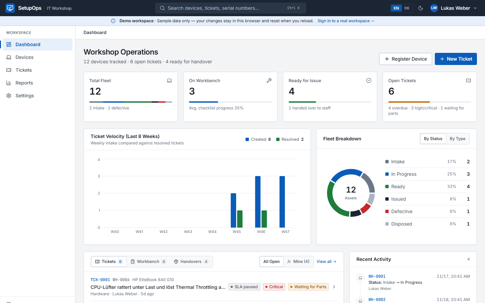
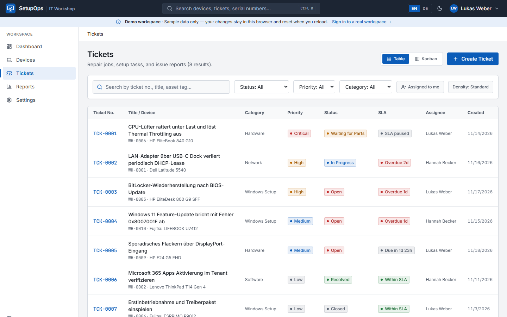
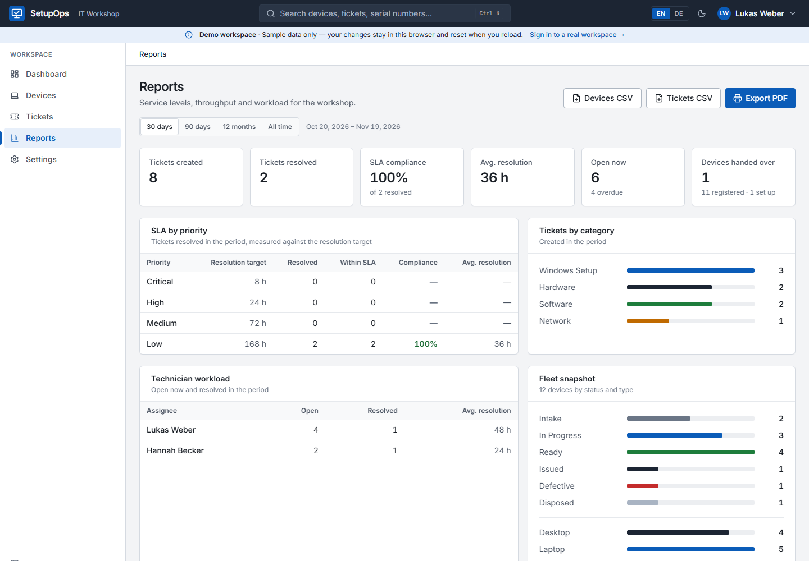
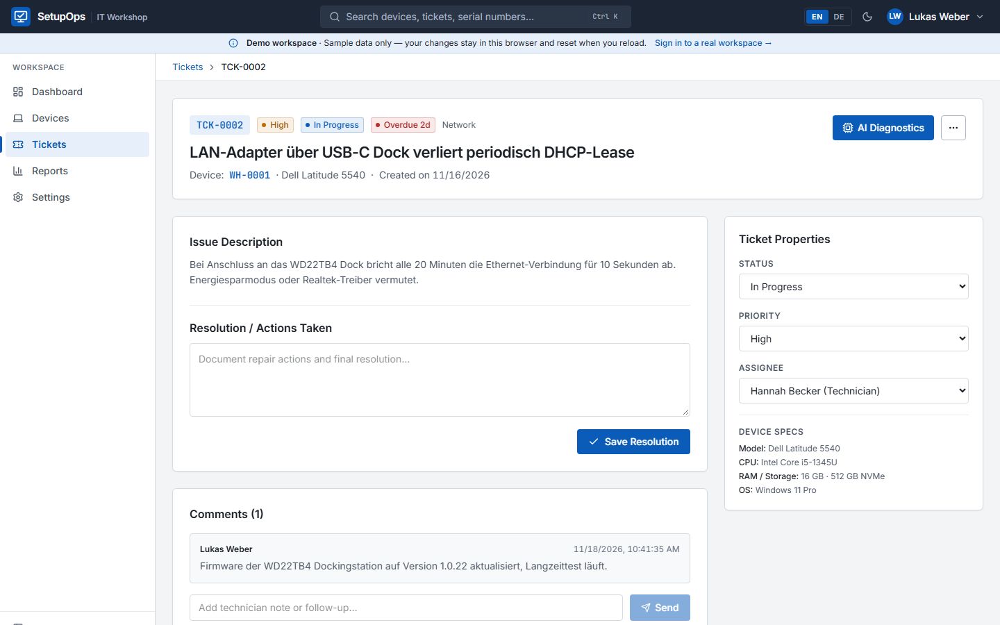
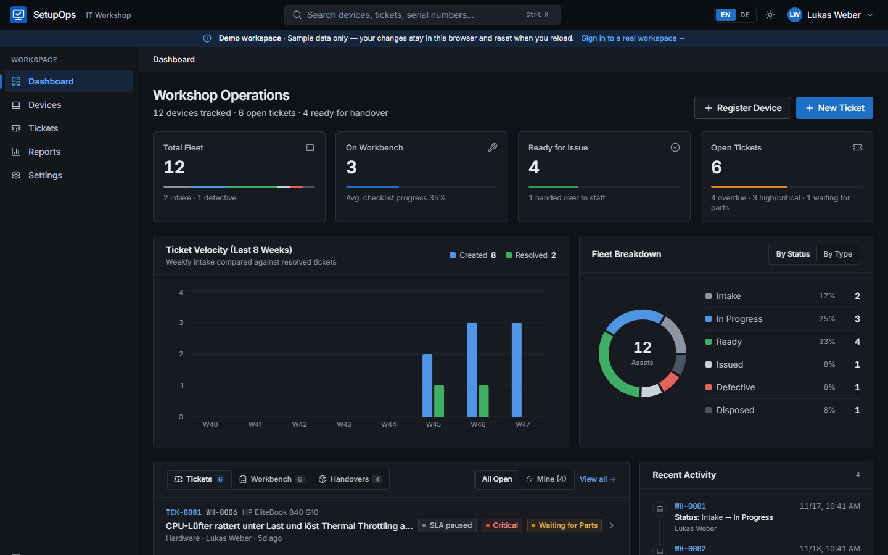
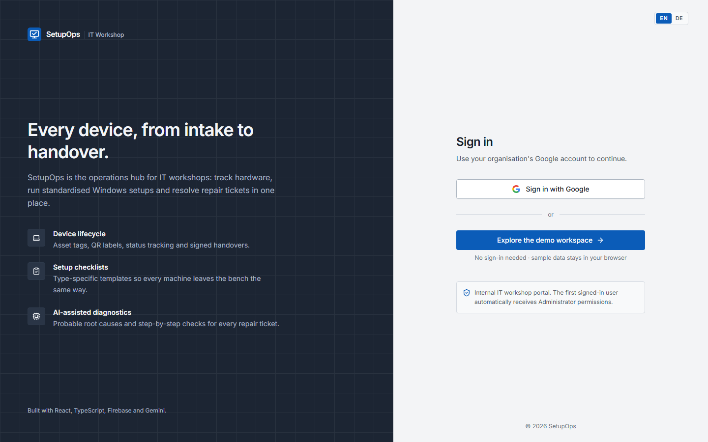
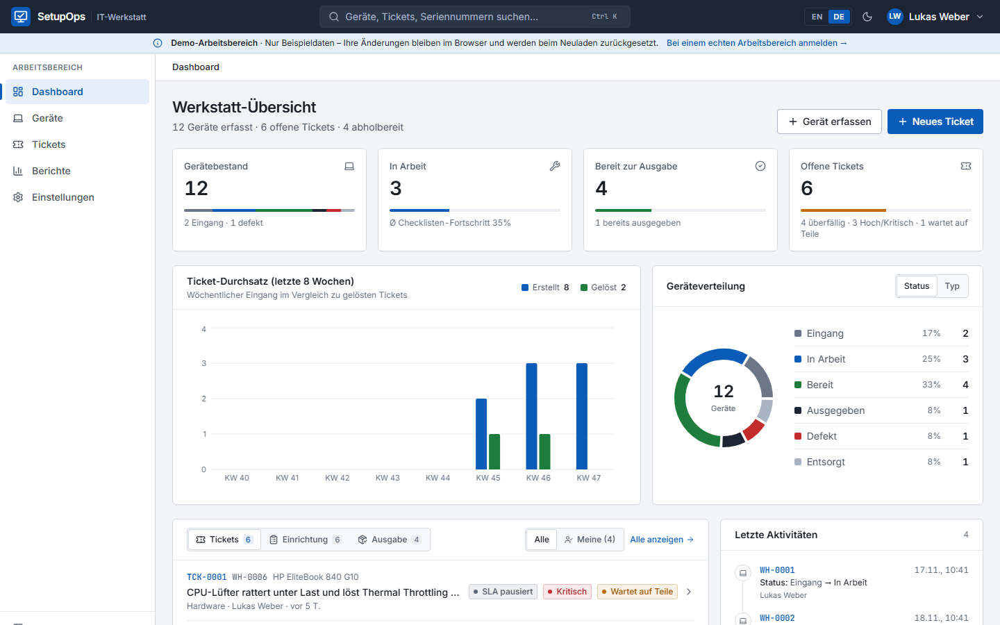
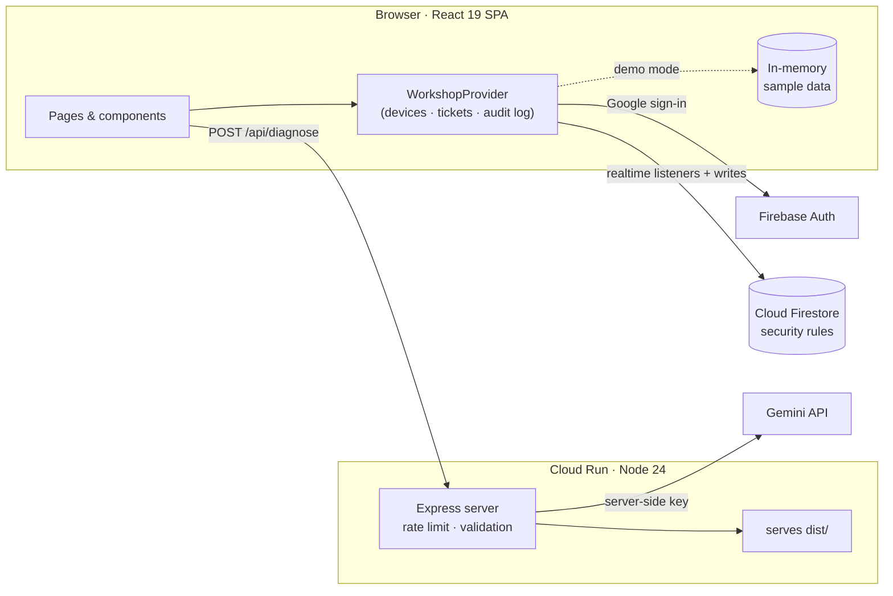

<div align="center">


# SetupOps

**Device lifecycle, repair tickets and Windows setup checklists for IT workshops — in one place.**




</div>

---

## Why

IT workshops (school IT, company help desks, refurbishers) juggle three things that usually live in three tools:
an **asset list** in a spreadsheet, **repair tickets** in a mail inbox, and **setup checklists** on paper.
SetupOps connects them: every device has a lifecycle, every ticket is tied to a device, and every setup
follows the same checklist — with an audit trail and SLA tracking on top.

> **Try it without an account:** open the app and choose **Explore the demo workspace**.
> The demo runs entirely in your browser with sample data; nothing is saved.

## Features

| Area | What it does |
| --- | --- |
| **Devices** | Intake (single or batch by serial numbers), asset tags `WH-0001…`, specs, status lifecycle *Intake → In Progress → Ready → Issued*, QR asset labels (62×29 mm or A4 sheet), handover & return with printable receipt |
| **Setup checklists** | Type-specific templates (laptop, desktop, monitor, other), per-item technician + timestamp, progress on the dashboard |
| **Tickets** | Table and drag-and-drop kanban, priorities, assignment, comments, resolution notes |
| **SLA tracking** | Resolution targets per priority (8 h – 7 d), *on track / at risk / overdue / paused* badges, "waiting for parts" pauses the clock |
| **AI diagnostics** | Gemini suggests probable root causes and hardware → software troubleshooting steps using device specs, checklist state and ticket history |
| **Device history** | Timeline of every change, handover and linked ticket, grouped by day and filterable |
| **Reports** | SLA compliance by priority, mean resolution time, technician workload, fleet snapshot · CSV export and print-ready PDF |
| **Workspace** | Roles (Admin / Technician), locations, checklist templates, Excel-friendly CSV export (UTF-8 BOM, `;`) |
| **Quality of life** | `Ctrl K` global search, English/German UI, light/dark theme, responsive down to phone width |

<table>
  <tr>
    <td></td>
    <td></td>
  </tr>
  <tr>
    <td></td>
    <td></td>
  </tr>
  <tr>
    <td></td>
    <td></td>
  </tr>
</table>

## Architecture



- **The browser talks to Firestore directly.** Authorization is enforced by [`firestore.rules`](firestore.rules), not by the client:
  strict schemas (`hasOnly`), immutable `createdAt`/`createdBy`, admin-only deletes, verified e-mail required.
  The threat model and the twelve rejected attack payloads are documented in [`security_spec.md`](security_spec.md).
- **The Gemini key never reaches the browser.** `/api/diagnose` runs on the server, validates input and is
  rate-limited per client IP (the endpoint is reachable from the public demo).
- **Roles.** The first user to sign in becomes Admin (atomic bootstrap document); everyone after that is a Technician.
  A break-glass `admin` custom claim can be granted with `npm run set-admin -- <email>` — no personal data in the rules.
- **Audit trail.** Every device and ticket change writes an audit entry; history views translate the stored entries
  for display instead of rewriting them.

### Code organisation

```text
src/
├─ pages/                 one lazy-loaded route each (Dashboard, Devices, Tickets, Reports, Settings…)
├─ components/
│  ├─ ui/                 Panel, PageHeader, SegmentedControl, OverflowMenu, badges, dialogs
│  ├─ dashboard/          KPI tiles, charts, work queue, activity feed
│  └─ device/             device history timeline
├─ hooks/workshop/        state provider split by domain: device / ticket / admin actions
├─ lib/                   pure, unit-tested logic — domain rules, SLA, reports, timeline, rate limiter
├─ i18n/                  typed EN/DE dictionaries (a missing German key is a compile error)
└─ index.css              design tokens (colours, radii, elevation) for light and dark themes
server.ts                 Express: static hosting + Gemini proxy
firestore.rules           authorization & schema validation
```

**Design system.** Components use semantic tokens only (`bg-surface`, `text-fg-muted`, `border-line`, `rounded-card`);
all raw colour values live in [`src/index.css`](src/index.css), so theming is a one-file change and charts follow the
active theme through CSS variables.

## Getting started

**Prerequisites:** Node.js ≥ 22.18 (Node 24 recommended) and a Firebase project with Google sign-in and Firestore enabled.

```bash
npm ci
cp .env.example .env        # add GEMINI_API_KEY for AI diagnostics
npm run dev                 # http://localhost:3000
```

Open `http://localhost:3000/?autostart=1` to use the local demo workspace without signing in.
Links also accept `?lang=de|en` and `?theme=light|dark`.

The Firebase web config lives in [`firebase-applet-config.json`](firebase-applet-config.json) (these values are public by design;
access is controlled by the security rules). Point it at your own project to run against your own data.

### Scripts

| Command | Purpose |
| --- | --- |
| `npm run dev` | Express + Vite dev server with HMR |
| `npm run check` | Everything CI runs: typecheck, Firestore rules lint, tests, production build |
| `npm test` | Unit tests (`node:test`) — domain rules, SLA, reports, timeline, i18n parity, rate limiter |
| `npm run build` / `npm start` | Production build / serve `dist/` + API |
| `npm run set-admin -- <email> [--revoke]` | Grant or revoke the break-glass admin claim (needs a service-account key) |

### Configuration

| Variable | Default | Description |
| --- | --- | --- |
| `GEMINI_API_KEY` | — | Required for AI diagnostics |
| `GEMINI_MODEL` | `gemini-4-hydrogen` | Model used by `/api/diagnose` |
| `DIAGNOSE_RATE_LIMIT` | `10` | AI requests per client IP per 10 minutes |
| `PORT` | `3000` | HTTP port (Cloud Run injects `8080`) |

## Quality

- **31 unit tests** on the pure logic in `src/lib` and the i18n dictionaries; run on every push by
  [GitHub Actions](.github/workflows/ci.yml) together with the typecheck, the security-rules linter, a production build
  and a container build.
- **Accessibility:** keyboard-operable menus and tabs, visible focus rings, `aria-*` labelling, text colour tokens
  chosen for WCAG-AA contrast in both themes, reduced-motion support.
- **Performance:** route-level code splitting; Firebase and React ship as separately cached vendor chunks, charts load
  only with the dashboard.

## Deployment

One container on **Google Cloud Run** serves the app and the API; Firestore rules and indexes deploy with the
Firebase CLI. Step-by-step instructions, including keyless GitHub → Google Cloud authentication and storing the
Gemini key in Secret Manager: **[docs/DEPLOYMENT.md](docs/DEPLOYMENT.md)**.

## Tech stack

React 19 · TypeScript · Vite · Tailwind CSS 4 · React Router 7 · Recharts · Firebase Auth & Firestore ·
Express · Google Gen AI SDK · Node 24 · Docker · GitHub Actions · Google Cloud Run

## Author & license

Built by **Aydarus Farah** · released under the [MIT License](LICENSE).
